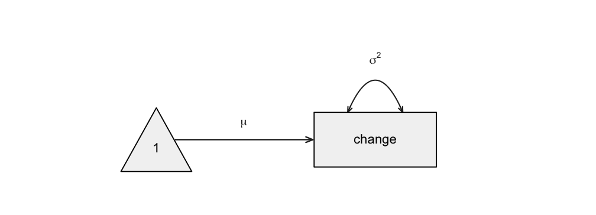
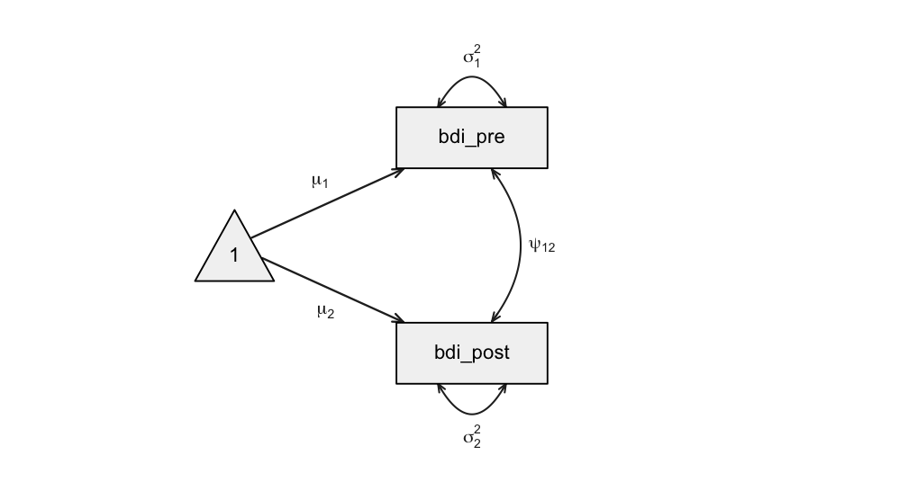
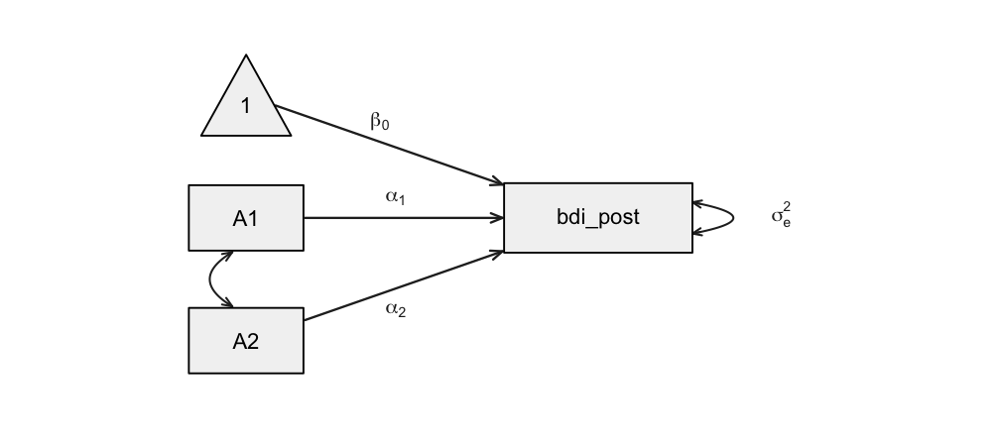
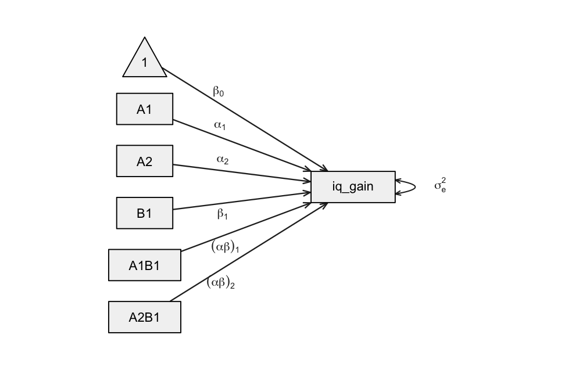
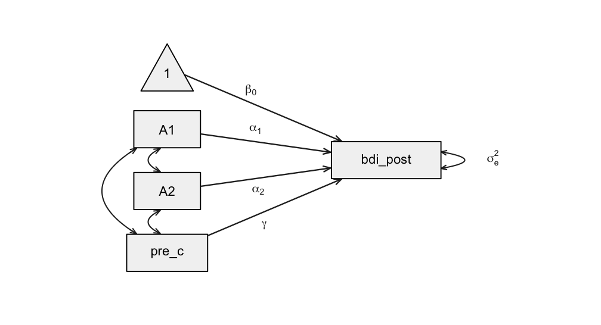

## What This Vignette Is For

Every analysis in the first two thirds of a first-year sequence, the single
sample *t* test, the paired *t* test, the one way analysis of variance, the
factorial analysis of variance, and the analysis of covariance, is the same
linear model with a different design matrix. Structural equation modeling
software fits that linear model too. So each of these classical analyses can
be written as a path model and estimated in `lavaan`, and the answers can be
made to agree with the textbook answers to the last decimal place.

Doing so is worth the trouble for three reasons. The first is conceptual: the
path diagram makes visible what a design factor actually contributes to a
model, which is a set of columns, and it makes visible that the choice of
those columns is a choice of hypothesis. The second is practical: once an
analysis of variance is a path model, the machinery of structural equation
modeling is available to it, including full information maximum likelihood
for missing data, latent variables in place of fallible observed outcomes,
and simultaneous models for several outcomes. The third is diagnostic: when
a path model and an `aov()` call disagree, the disagreement is always
informative, and this vignette is largely about the two places it comes from.

The examples follow the running examples of Maxwell, Delaney, and Kelley
(2027) and use data that ship with DMAR. The companion vignette
`vignette("sums_of_squares", package = "DMAR")` treats the sums of squares
types in their own right; here they appear only where the coding of a factor
forces the issue.

## The Two Facts That Make the Equivalence Exact

Two things stand between a naive `lavaan` path model and the classical
answer. Neither is subtle once stated, and both recur in every section
below.

### A Factor Is Not a Variable, It Is a Set of Columns

R hides this. When `aov()` is handed `y ~ condition` with a three-level
`condition`, it silently builds two numeric columns and regresses on them.
`lavaan` does not build them for you: its model syntax takes variables, so
the columns must be constructed before the model is written. That turns out
to be a feature for teaching, because the choice of columns is exactly the
choice of what the eventual test means, and the section
"Coding a Factor" below is devoted to it.

### Maximum Likelihood Divides by *N*, the Classical Test Divides by the Error Degrees of Freedom

The maximum likelihood estimate of a residual variance is

$$ \hat\sigma^2_{\mathrm{ML}} \;=\; \frac{\mathrm{SSE}}{N}, $$

whereas every classical *t* and *F* statistic uses the unbiased estimate

$$ \mathrm{MSE} \;=\; \frac{\mathrm{SSE}}{\mathit{df}_{\mathrm{error}}}. $$

`lavaan` reports the first. Its standard errors are therefore slightly too
small, its *z* statistics slightly too large, and its *p*-values slightly too
small. The two estimates differ by the factor $N / \mathit{df}_{\mathrm{error}}$,
so every classical statistic is recovered exactly by rescaling:

$$ t \;=\; z \sqrt{\frac{\mathit{df}_{\mathrm{error}}}{N}}, \qquad
   F \;=\; \frac{W}{q}\cdot\frac{\mathit{df}_{\mathrm{error}}}{N}, $$

where $W$ is the Wald chi square statistic for a set of $q$ constraints and
$\mathit{df}_{\mathrm{error}}$ is the error degrees of freedom of the
corresponding classical analysis. The correction is not a fudge factor. It is
the statement that the classical test refers its evidence to a distribution
with finite degrees of freedom, while the Wald statistic refers to its large
sample limit.

The whole of the rescaling is these two functions, used throughout.


``` r
# Convert a lavaan z statistic into the classical t statistic.
z_to_t <- function(z, N, df_error) {
  t_value <- z * sqrt(df_error / N)
  data.frame(term = c("t_value", "df", "p_value"),
             value = c(t_value, df_error,
                       2 * pt(abs(t_value), df_error, lower.tail = FALSE)))
}

# Convert a lavaan Wald chi square for q constraints into the classical F.
W_to_F <- function(W, q, N, df_error) {
  F_value <- (W / q) * (df_error / N)
  data.frame(term = c("F_value", "df_1", "df_2", "p_value"),
             value = c(F_value, q, df_error,
                       pf(F_value, q, df_error, lower.tail = FALSE)))
}
```

One point of care about `fixed.x`. In a designed experiment the code
variables are constants that the investigator assigned, not random variables
sampled from a population, and a covariate measured before randomization is
conditioned upon in the classical analysis as well. Setting
`fixed.x = TRUE`, which is the default for exogenous variables in `lavaan`
when a model has no latent variables, encodes exactly that: the model
conditions on the predictors and estimates nothing about their distribution.
With `fixed.x = FALSE` the model would spend parameters estimating means and
covariances among design constants, which changes the fit statistics and has
no substantive referent in an experiment.

## The Data

Two data sets carry the whole vignette.

`depression_bdi` is the three-group depression study of Maxwell, Delaney,
and Kelley (2027, Chapter 9, Table 9.7). Thirty depressive individuals were
assigned at random, ten per group, to a selective serotonin reuptake
inhibitor, to a placebo, or to a wait list. Depression was measured on the
Beck Depression Inventory before treatment and again afterward, so the data
support a paired comparison, a one way analysis of variance on the post-test,
and an analysis of covariance that uses the pre-test as the covariate.


``` r
data(depression_bdi)
descriptives(depression_bdi[, c("bdi_pre", "bdi_post")])$descriptives
#>   variable    type  n n_missing prop_missing     mean median       sd min max
#> 1  bdi_pre numeric 30         0            0 17.36667     16 5.102287   9  29
#> 2 bdi_post numeric 30         0            0 11.16667     10 6.721470   0  25
#>    q25   q75  skewness   kurtosis
#> 1 14.0 20.75 0.4091667 -0.5022401
#> 2  7.5 15.00 0.1844200 -0.4817713

# Cell means, which every model below is a reparameterization of.
round(with(depression_bdi,
           cbind(pre  = tapply(bdi_pre,  condition, mean),
                 post = tapply(bdi_post, condition, mean))), 3)
#>            pre post
#> ssri      17.0  7.3
#> placebo   17.7 12.2
#> wait_list 17.4 14.0
```

`pygmalion` is the teacher expectancy experiment of Rosenthal and Jacobson
(1968). Within each of grades 1 through 6, a randomly chosen fifth of the
children were identified to their teachers as "bloomers" who would show
unusual intellectual gains in the coming year, although the names had in fact
been drawn at random. The outcome used here is `iq_gain`, the change in
measured IQ over the year. Grade is collapsed into three bands so that the
design is a 3 by 2 factorial, and because the expectancy effect was reported
to concentrate in the earliest grades.


``` r
data(pygmalion)
pygmalion$band <- factor(
  ifelse(pygmalion$grade <= 2, "early",
         ifelse(pygmalion$grade <= 4, "middle", "late")),
  levels = c("early", "middle", "late"))

table(pygmalion$band, pygmalion$treatment)
#>         
#>          Control Bloomer
#>   early       91      19
#>   middle      87      25
#>   late        68      20
```

The cell sizes are very unequal, which is what makes `pygmalion` useful: it
is used first in a balanced subsample, where the classical decomposition is
unique, and then in full, where it is not.

## The Single Sample *t* Test

The question is whether the wait list participants changed at all over the
interval, when nothing was done for them. The outcome is the change score,
post-test minus pre-test, and the null hypothesis is that its mean is zero.



The model has one free mean and one free variance, so it is saturated: it
reproduces the sample mean and the sample variance exactly and has zero
degrees of freedom as a model. All of the inference lives in the intercept.


``` r
wl <- subset(depression_bdi, condition == "wait_list")
wl$change <- wl$bdi_post - wl$bdi_pre
N <- nrow(wl)

fit_t1 <- sem("change ~ 1", data = wl, meanstructure = TRUE)
pe_t1  <- parameterEstimates(fit_t1)
pe_t1[pe_t1$op == "~1", c("lhs", "est", "se", "z", "pvalue")]
#>      lhs  est    se      z pvalue
#> 1 change -3.4 1.457 -2.333   0.02
```

The estimate is the sample mean and needs no correction. The standard error
and the *z* statistic do, because the variance behind them was divided by
$N = 10$ rather than by $\mathit{df}_{\mathrm{error}} = N - 1 = 9$.


``` r
z_t1 <- pe_t1$z[pe_t1$op == "~1"]
z_to_t(z_t1, N = N, df_error = N - 1)
#>      term       value
#> 1 t_value -2.21321149
#> 2      df  9.00000000
#> 3 p_value  0.05416072

# The classical test.
t.test(wl$change, mu = 0)
#> 
#> 	One Sample t-test
#> 
#> data:  wl$change
#> t = -2.2132, df = 9, p-value = 0.05416
#> alternative hypothesis: true mean is not equal to 0
#> 95 percent confidence interval:
#>  -6.87519177  0.07519177
#> sample estimates:
#> mean of x 
#>      -3.4
```


The corrected statistic agrees with `t.test()` exactly. A nonzero null is a
constraint on the intercept rather than a different model, which is worth
seeing once because it is the same device that carries every test later in
the vignette.


``` r
fit_t1b <- sem("change ~ mu * 1", data = wl, meanstructure = TRUE)
W <- lavTestWald(fit_t1b, constraints = "mu == -5")$stat
W_to_F(W, q = 1, N = N, df_error = N - 1)   # F on 1 and N - 1 df is t squared
#>      term    value
#> 1 F_value 1.084746
#> 2    df_1 1.000000
#> 3    df_2 9.000000
#> 4 p_value 0.324807

t.test(wl$change, mu = -5)$statistic^2
#>        t 
#> 1.084746
```

The wait list participants improved by
-3.4 points on average, but the interval is
consistent with no change
(*t*(9) = -2.213,
*p* = 0.0542, 95% CI
[-6.88, 0.08]).

## The Paired Samples *t* Test

The same device answers a different question for the treated group: did the
participants who received the serotonin reuptake inhibitor improve from
pre-test to post-test?

Forming the change score by hand, as above, would work. The more instructive
path model leaves the two measurements as they are, gives each its own mean,
lets them covary, and defines the difference as a function of the two means.
This is the model a reader of a structural equation modeling text would
recognize, and it generalizes directly: with three or more occasions it
becomes a repeated measures model, and with several indicators per occasion
it becomes a latent change model.




``` r
ss <- subset(depression_bdi, condition == "ssri")
N  <- nrow(ss)

model_t2 <- "
  bdi_pre  ~ m1 * 1
  bdi_post ~ m2 * 1
  bdi_pre  ~~ bdi_post          # the paired part of the paired test
  change   := m2 - m1           # the estimand, as a function of two means
"
fit_t2 <- sem(model_t2, data = ss, meanstructure = TRUE)

pe_t2 <- parameterEstimates(fit_t2)
pe_t2[pe_t2$op == ":=", c("label", "est", "se", "z", "pvalue")]
#>    label  est   se     z pvalue
#> 6 change -9.7 1.53 -6.34      0
```

`lavaan` obtains the standard error of the defined parameter by the delta
method, which here reduces to
$\sqrt{(\sigma^2_1 + \sigma^2_2 - 2\sigma_{12}) / n}$, the standard error of
the difference score. The same correction as before turns it into the
classical statistic.


``` r
z_to_t(pe_t2$z[pe_t2$op == ":="], N = N, df_error = N - 1)
#>      term         value
#> 1 t_value -6.0143996375
#> 2      df  9.0000000000
#> 3 p_value  0.0001989574

t.test(ss$bdi_post, ss$bdi_pre, paired = TRUE)
#> 
#> 	Paired t-test
#> 
#> data:  ss$bdi_post and ss$bdi_pre
#> t = -6.0144, df = 9, p-value = 0.000199
#> alternative hypothesis: true mean difference is not equal to 0
#> 95 percent confidence interval:
#>  -13.348398  -6.051602
#> sample estimates:
#> mean difference 
#>            -9.7
```


Two features of this model repay attention. It is saturated, with
0 degrees of freedom, because five
parameters reproduce two means, two variances, and one covariance; a
saturated model is what an exact reproduction of a classical test always
requires. And deleting the single line `bdi_pre ~~ bdi_post` would convert it
into the independent samples test, which is a vivid way of showing what
pairing buys.

Participants receiving the serotonin reuptake inhibitor improved by
-9.7 points on the Beck Depression
Inventory (*t*(9) =
-6.014,
*p* = 0.0002,
95% CI
[-13.35, -6.05]).
Whether that improvement exceeds what the placebo and wait list groups
show is the question the next sections take up, and it is not the same
question.

## Coding a Factor: What the Columns Mean

This is the section the rest of the vignette depends on.

### The Model That Cannot Be Fitted

Write the three-group design in the form the textbook does, with a grand
mean and a deviation for each group:

$$ \mu_j \;=\; \mu + \alpha_j, \qquad j = 1, 2, 3 .$$

There are three cell means on the left and four parameters on the right.
No data can tell the four apart: adding a constant to $\mu$ and subtracting
it from every $\alpha_j$ leaves all three cell means unchanged. The design
matrix is rank deficient and the parameters are not estimable. To fit the
model, one restriction has to be imposed, and imposing it is all that a
coding scheme does. A coding scheme is a choice of restriction, that is, a
choice of which full rank set of columns will stand in for the factor.

Every coding scheme spans the same column space. So the fitted cell means,
the residuals, the error sum of squares, and $R^2$ are the same under all of
them. What changes is what an individual coefficient means, and, once more
than one factor is present, what a test of a set of coefficients means.

### Indicator Coding, Which R Uses by Default

R's default for an unordered factor is `contr.treatment`, usually called
dummy or indicator coding. The restriction is $\alpha_1 = 0$: the first level
is made the reference and the other levels are expressed relative to it.


``` r
d <- depression_bdi
contrasts(d$condition) <- contr.treatment(3)
unique(cbind(condition = as.character(d$condition),
             as.data.frame(model.matrix(~ condition, d))))
#>    condition (Intercept) condition2 condition3
#> 1       ssri           1          0          0
#> 11   placebo           1          1          0
#> 21 wait_list           1          0          1
```

Reading the columns as a human would: the first column is the intercept, on
in every row. The second column is on only for placebo participants, so its
coefficient is the amount by which placebo differs from the reference group,
here the serotonin reuptake inhibitor. The third is on only for the wait
list, so its coefficient is the wait list difference from the same reference.
The intercept is the mean of the reference group itself, not any kind of
average.

Indicator coding is the right choice when the reference level is
substantively privileged, as a control or placebo arm often is, because then
every coefficient is a comparison a reader wants.

### Effects Coding, Which the Analysis of Variance Assumes

The restriction the analysis of variance imposes is instead
$\sum_j \alpha_j = 0$, that the group deviations sum to zero. This is
`contr.sum`, called effects coding. DMAR supplies `effects_coding()`, which
builds the same matrix but names its columns after the levels they represent,
so that the model output is readable.


``` r
contrasts(d$condition) <- effects_coding(levels(d$condition))
effects_coding(levels(d$condition))
#>           ssri placebo
#> ssri         1       0
#> placebo      0       1
#> wait_list   -1      -1

unique(cbind(condition = as.character(d$condition),
             as.data.frame(model.matrix(~ condition, d))))
#>    condition (Intercept) conditionssri conditionplacebo
#> 1       ssri           1             1                0
#> 11   placebo           1             0                1
#> 21 wait_list           1            -1               -1
```

Reading these columns: the `ssri` column is 1 for the serotonin reuptake
inhibitor group, 0 for placebo, and -1 for the wait list. The last level is
not a reference in the sense that indicator coding uses the word. It is the
level whose deviation is not given a column, because the restriction already
determines it: the three deviations sum to zero, so the third is minus the
sum of the first two. Every level is represented; one of them is represented
implicitly.

The consequence is that the coefficients mean something different, and the
difference is exactly the difference between the two ways of averaging.


``` r
fit_lm <- lm(bdi_post ~ condition, data = d)
round(coef(fit_lm), 6)
#>      (Intercept)    conditionssri conditionplacebo 
#>        11.166667        -3.866667         1.033333

cell_means <- tapply(d$bdi_post, d$condition, mean)
round(c(cell_means, grand = mean(cell_means)), 6)
#>      ssri   placebo wait_list     grand 
#>   7.30000  12.20000  14.00000  11.16667
```

The intercept is the unweighted mean of the three cell means, and each
coefficient is one cell mean minus that grand mean. Under indicator coding
the intercept was a single group's mean. Here it is the center of the design.

### Why the Choice Does Not Matter Yet

In a one way design, both codings give the same omnibus test, because the
joint hypothesis they express is the same one. Under indicator coding the
two coefficients are $\mu_2 - \mu_1$ and $\mu_3 - \mu_1$, so setting both to
zero says all three means are equal. Under effects coding they are
$\mu_1 - \bar\mu$ and $\mu_2 - \bar\mu$, so setting both to zero says the
first two means equal the grand mean, and the sum to zero restriction forces
the third to as well. Same hypothesis, different route.


``` r
d_dummy   <- d; contrasts(d_dummy$condition)   <- contr.treatment(3)
d_effects <- d; contrasts(d_effects$condition) <- contr.sum(3)

c(dummy   = anova(lm(bdi_post ~ condition, d_dummy))[1, "F value"],
  effects = anova(lm(bdi_post ~ condition, d_effects))[1, "F value"])
#>    dummy  effects 
#> 3.034776 3.034776
```

The choice starts to matter the moment a second factor and its interaction
enter the model, because then the columns for one factor are multiplied by
the columns for the other. That is the subject of the two way sections, and
the rule that emerges there is worth stating in advance: a factor's main
effect test comes out right when the *other* factor is coded to sum to zero.

## The One Way ANOVA

The substantive question is whether the three conditions differed on
post-test depression.



The code variables are built once and carried into a plain data frame, which
is what `lavaan` wants.


``` r
contrasts(d$condition) <- effects_coding(levels(d$condition))
X <- model.matrix(~ condition, d)
colnames(X) <- c("intercept", "A1", "A2")

dat1 <- data.frame(bdi_post = d$bdi_post, X[, c("A1", "A2")])
head(dat1, 3)
#>   bdi_post A1 A2
#> 1       12  1  0
#> 2        0  1  0
#> 3       10  1  0
```


``` r
model_1 <- "
  bdi_post ~ a1 * A1 + a2 * A2
  bdi_post ~ 1
"
fit_1 <- sem(model_1, data = dat1, fixed.x = TRUE, meanstructure = TRUE)

N <- lavaan::nobs(fit_1)
p <- 3                     # intercept plus two code variables
df_error <- N - p

parameterEstimates(fit_1)[1:3, c("lhs", "rhs", "est", "se", "z", "pvalue")]
#>        lhs rhs    est    se      z pvalue
#> 1 bdi_post  A1 -3.867 1.542 -2.508  0.012
#> 2 bdi_post  A2  1.033 1.542  0.670  0.503
#> 3 bdi_post     11.167 1.090 10.243  0.000
```

The omnibus null hypothesis is that the factor contributes nothing, which is
a joint constraint on both of its coefficients at once. A test of one
coefficient at a time is not the analysis of variance.


``` r
W <- lavTestWald(fit_1, constraints = "a1 == 0; a2 == 0")$stat
W_to_F(W, q = 2, N = N, df_error = df_error)
#>      term       value
#> 1 F_value  3.03477611
#> 2    df_1  2.00000000
#> 3    df_2 27.00000000
#> 4 p_value  0.06473342

print_anova(anova(lm(bdi_post ~ condition, data = d)))
#> Analysis of Variance Table
#> 
#> Response: bdi_post
#> 
#>           Df    Sum Sq   Mean Sq  F value Pr(>F)
#> condition  2  240.4667 120.23333 3.034776 0.0647
#> Residuals 27 1069.7000  39.61852       NA   <NA>
```


The two agree exactly. The sums of squares can be read off the path model as
well, since the maximum likelihood residual variance times *N* is the error
sum of squares.


``` r
SSE <- N * coef(fit_1)[["bdi_post~~bdi_post"]]
c(SSE_from_lavaan = SSE,
  SSE_from_aov    = anova(lm(bdi_post ~ condition, data = d))[2, "Sum Sq"])
#> SSE_from_lavaan    SSE_from_aov 
#>          1069.7          1069.7
```

The omnibus effect size and its confidence interval:


``` r
a1 <- anova(lm(bdi_post ~ condition, data = d))
es_1 <- ci_eta_squared(F_value = a1[1, "F value"], df_effect = 2,
                       df_error = df_error, N = N, estimand = "partial")
#> Warning: The observed F_value is below the alpha_lower critical value of the
#> central F-distribution, so the lower confidence limit on partial eta squared is
#> 0.
es_1
```


|effect  |eta_squared_partial |eta_squared_partial_ci_lower |eta_squared_partial_ci_upper |F_value |df_effect |df_error |N  |
|:-------|:-------------------|:----------------------------|:----------------------------|:-------|:---------|:--------|:--|
|overall |0.184               |0.000                        |0.388                        |3.035   |2         |27       |30 |

Confidence level: 95%


On post-test depression the three conditions gave
*F*(2, 27) = 3.035,
*p* = 0.0647, partial eta squared =
0.184, 95% CI
[0, 0.388]. The interval
runs from zero to 0.388, so these data are consistent
with the conditions accounting for none of the variability in post-test
depression and equally consistent with their accounting for a substantial
share of it. That is the sample size speaking rather than the treatments. The analysis of covariance section returns to these same data and
reaches a different conclusion, for a reason worth understanding.

## The Two Way Factorial, Balanced

A 3 by 2 factorial needs five code variables: two for the three-level factor,
one for the two-level factor, and the two products that carry the
interaction. The products are built from the coded columns, never from the
factor levels directly, which is the step where an incorrect coding does its
damage.



To keep the first factorial example orthogonal, take a balanced subsample
with as many children per cell as the smallest cell allows.


``` r
set.seed(113)
n_cell <- min(table(pygmalion$band, pygmalion$treatment))
idx <- unlist(lapply(
  split(seq_len(nrow(pygmalion)), list(pygmalion$band, pygmalion$treatment)),
  function(i) sample(i, n_cell)))
balanced <- droplevels(pygmalion[sort(idx), ])

table(balanced$band, balanced$treatment)
#>         
#>          Control Bloomer
#>   early       19      19
#>   middle      19      19
#>   late        19      19
```

One function builds the five columns, so that the balanced and unbalanced
analyses differ in nothing but their data.


``` r
design_3x2 <- function(dat) {
  dat$band      <- factor(dat$band)
  dat$treatment <- factor(dat$treatment)
  contrasts(dat$band)      <- effects_coding(levels(dat$band))
  contrasts(dat$treatment) <- effects_coding(levels(dat$treatment))
  X <- model.matrix(~ band * treatment, dat)
  colnames(X) <- c("intercept", "A1", "A2", "B1", "A1B1", "A2B1")
  data.frame(iq_gain = dat$iq_gain, X[, -1])
}

dat2 <- design_3x2(balanced)
head(dat2, 3)
#>    iq_gain A1 A2 B1 A1B1 A2B1
#> 9       -7  1  0  1    1    0
#> 13      55  1  0  1    1    0
#> 14      25  1  0  1    1    0
```


``` r
model_2 <- "
  iq_gain ~ a1 * A1 + a2 * A2 + b1 * B1 + ab1 * A1B1 + ab2 * A2B1
  iq_gain ~ 1
"
fit_2 <- sem(model_2, data = dat2, fixed.x = TRUE, meanstructure = TRUE)

N <- lavaan::nobs(fit_2)
p <- 6                     # intercept plus five code variables
df_error <- N - p

anova_from_path <- function(fit, N, df_error) {
  rbind(
    band             = W_to_F(lavTestWald(fit, "a1 == 0; a2 == 0")$stat,
                              2, N, df_error)$value,
    treatment        = W_to_F(lavTestWald(fit, "b1 == 0")$stat,
                              1, N, df_error)$value,
    `band:treatment` = W_to_F(lavTestWald(fit, "ab1 == 0; ab2 == 0")$stat,
                              2, N, df_error)$value)
}

res_2 <- anova_from_path(fit_2, N, df_error)
colnames(res_2) <- c("F_value", "df_1", "df_2", "p_value")
round(res_2, 6)
#>                 F_value df_1 df_2  p_value
#> band           3.450047    2  108 0.035284
#> treatment      0.314051    1  108 0.576366
#> band:treatment 1.251653    2  108 0.290147
```

The classical analysis agrees to every digit shown.


``` r
print_anova(anova(lm(iq_gain ~ band * treatment, data = balanced)))
#> Analysis of Variance Table
#> 
#> Response: iq_gain
#> 
#>                 Df      Sum Sq   Mean Sq   F value Pr(>F)
#> band             2  1596.00000 798.00000 3.4500474 0.0353
#> treatment        1    72.64035  72.64035 0.3140509 0.5764
#> band:treatment   2   579.01754 289.50877 1.2516529 0.2901
#> Residuals      108 24980.52632 231.30117        NA   <NA>
```


With equal cell sizes the code variables for the three effects are mutually
orthogonal, so each effect's sum of squares is the same no matter what else
is in the model and the three add up to the model sum of squares. There is
one partition and no choice to make. The design matrix shows this directly:
the cross-product matrix is block diagonal.


``` r
X <- as.matrix(cbind(intercept = 1, dat2[, -1]))
round(crossprod(X), 6)
#>           intercept A1 A2  B1 A1B1 A2B1
#> intercept       114  0  0   0    0    0
#> A1                0 76 38   0    0    0
#> A2                0 38 76   0    0    0
#> B1                0  0  0 114    0    0
#> A1B1              0  0  0   0   76   38
#> A2B1              0  0  0   0   38   76
```

Under indicator coding not one of those off-diagonal blocks would be zero,
even with perfectly equal cell sizes, which is the first hint that indicator
coding and the analysis of variance are not speaking the same language.

## The Two Way Factorial With Unequal Sample Sizes

Now use all 310 children. The cells are badly unbalanced,
the effects are no longer orthogonal, and the coding of the factors becomes
consequential.


``` r
dat3 <- design_3x2(pygmalion)
fit_3 <- sem(model_2, data = dat3, fixed.x = TRUE, meanstructure = TRUE)

N <- lavaan::nobs(fit_3)
df_error <- N - 6

res_3 <- anova_from_path(fit_3, N, df_error)
colnames(res_3) <- c("F_value", "df_1", "df_2", "p_value")
round(res_3, 6)
#>                  F_value df_1 df_2  p_value
#> band           12.938047    2  304 0.000004
#> treatment       4.963087    1  304 0.026626
#> band:treatment  3.365752    2  304 0.035828
```

These are Type III tests, and DMAR's `factorial_anova()` agrees.


``` r
factorial_anova(iq_gain ~ band * treatment, data = pygmalion,
                ss_type = 3)[, c("effect", "SS", "df", "F_value", "p_value")]
#> Warning: The noncentral F lower-limit clamp in ci_nc_F() fired for 4 of the
#> effect size confidence intervals; the affected lower limits were clamped to 0.
#> See ?ci_nc_F for the meaning of the clamp.
```


|effect         |SS        |df  |F_value |p_value  |
|:--------------|:---------|:---|:-------|:--------|
|band           |4407.490  |2   |12.938  |< 0.0001 |
|treatment      |845.366   |1   |4.963   |0.0266   |
|band:treatment |1146.581  |2   |3.366   |0.0358   |
|Residuals      |51780.497 |304 |NA      |NA       |


Sequential, Type I tests of the same data give different answers for the two
main effects, because each is then adjusted only for what precedes it in the
formula.


``` r
print_anova(anova(lm(iq_gain ~ band * treatment, data = pygmalion)))
#> Analysis of Variance Table
#> 
#> Response: iq_gain
#> 
#>                 Df     Sum Sq   Mean Sq   F value   Pr(>F)
#> band             2  4767.1034 2383.5517 13.993680 < 0.0001
#> treatment        1   783.8963  783.8963  4.602205   0.0327
#> band:treatment   2  1146.5810  573.2905  3.365752   0.0358
#> Residuals      304 51780.4968  170.3306        NA     <NA>
```

The interaction is identical across the types, as it always is for the last
term entered, and the main effects are not. Which type answers the intended
question is the subject of
`vignette("sums_of_squares", package = "DMAR")`. The point here is the one
the path model makes unavoidable: the Type III test is what a joint
constraint on effects-coded columns delivers, and it is not what a joint
constraint on indicator-coded columns delivers.

### What the Coding Actually Controls

Refit the same design under several coding combinations and watch which
numbers move.


``` r
F_joint <- function(model, rows) {
  b <- coef(model); V <- vcov(model)
  L <- diag(length(b))[rows, , drop = FALSE]
  drop(t(L %*% b) %*% solve(L %*% V %*% t(L)) %*% (L %*% b)) / nrow(L)
}

compare_coding <- function(contrast_band, contrast_treatment) {
  dd <- pygmalion
  contrasts(dd$band)      <- contrast_band(3)
  contrasts(dd$treatment) <- contrast_treatment(2)
  m <- lm(iq_gain ~ band * treatment, data = dd)   # 1, A1, A2, B1, A1B1, A2B1
  c(F_band = F_joint(m, 2:3), F_treatment = F_joint(m, 4),
    F_interaction = F_joint(m, 5:6), SSE = sum(residuals(m)^2))
}

combinations <- list(
  "effects / effects" = c(contr.sum,       contr.sum),
  "helmert / effects" = c(contr.helmert,   contr.sum),
  "dummy   / effects" = c(contr.treatment, contr.sum),
  "effects / dummy"   = c(contr.sum,       contr.treatment),
  "dummy   / dummy"   = c(contr.treatment, contr.treatment))

round(t(sapply(combinations, function(cc) compare_coding(cc[[1]], cc[[2]]))), 5)
#>                     F_band F_treatment F_interaction     SSE
#> effects / effects 12.93805     4.96309       3.36575 51780.5
#> helmert / effects 12.93805     4.96309       3.36575 51780.5
#> dummy   / effects 12.93805    11.09676       3.36575 51780.5
#> effects / dummy   10.29746     4.96309       3.36575 51780.5
#> dummy   / dummy   10.29746    11.09676       3.36575 51780.5
```

Three things are visible at once.

The error sum of squares and the interaction *F* never move. All of these
codings span the same column space, so the fitted values are identical and
so is everything computed from them alone.

The main effect of band depends only on how *treatment* is coded, not on how
band is coded. Effects coding, Helmert coding, and indicator coding of band
all give 12.938 as long as treatment sums to zero. The
reason is in how the interaction columns are built: the code variables for
band are multiplied by the code variables for treatment, so what the band
coefficients mean is controlled by whether the treatment codes average to
zero across treatment's levels.

Symmetrically, the main effect of treatment depends only on how band is
coded. Both main effects have their intended meaning at the same time only
when the codes of both factors sum to zero, as effects coding and Helmert
coding do.

### What the Indicator-Coded Test Is Actually Testing

It is not that indicator coding gives a wrong answer. It gives a correct
answer to a different question: the simple effect of one factor within the
reference level of the other.


``` r
cell_fit <- lm(iq_gain ~ 0 + band:treatment, data = pygmalion)
mu <- coef(cell_fit)
round(mu, 4)
#>  bandearly:treatmentControl bandmiddle:treatmentControl 
#>                      9.5604                      4.0000 
#>   bandlate:treatmentControl  bandearly:treatmentBloomer 
#>                     13.4265                     20.5263 
#> bandmiddle:treatmentBloomer   bandlate:treatmentBloomer 
#>                      5.4400                     13.3500

# The hypothesis that the three band means are equal within Control only.
L <- matrix(0, nrow = 2, ncol = length(mu))
control <- grep("treatmentControl", names(mu))
L[1, control[1]] <-  1; L[1, control[2]] <- -1
L[2, control[2]] <-  1; L[2, control[3]] <- -1

W <- drop(t(L %*% mu) %*% solve(L %*% vcov(cell_fit) %*% t(L)) %*% (L %*% mu))
c(simple_effect_within_Control = W / 2,
  dummy_coded_band_test        = compare_coding(contr.treatment,
                                                contr.treatment)[["F_band"]])
#> simple_effect_within_Control        dummy_coded_band_test 
#>                     10.29746                     10.29746
```


Identical. A researcher who leaves R's default contrasts in place, fits a
factorial model, and reads the joint test of a factor's coefficients as a
main effect has reported a simple effect and called it something else. The
two coincide only when the interaction is exactly zero, which is why the
error is invisible in an additive model and easy to make in a factorial one.

### Weighted and Unweighted Marginal Means

Effects coding estimates the unweighted marginal means, giving each cell
equal say regardless of how many children happened to land in it. With
unequal cell sizes this differs from the ordinary marginal mean.


``` r
cells <- tapply(pygmalion$iq_gain, list(pygmalion$band, pygmalion$treatment), mean)
round(cbind(cells,
            unweighted = rowMeans(cells),
            weighted   = tapply(pygmalion$iq_gain, pygmalion$band, mean)), 4)
#>        Control Bloomer unweighted weighted
#> early   9.5604 20.5263    15.0434  11.4545
#> middle  4.0000  5.4400     4.7200   4.3214
#> late   13.4265 13.3500    13.3882  13.4091

dd <- pygmalion
contrasts(dd$band) <- contr.sum(3); contrasts(dd$treatment) <- contr.sum(2)
round(coef(lm(iq_gain ~ band * treatment, data = dd))[1:3], 6)
#> (Intercept)       band1       band2 
#>   11.050538    3.992840   -6.330538
```

The intercept is the unweighted grand mean, 11.0505,
and the two band coefficients are that mean subtracted from the unweighted
early and middle band means. In a designed experiment the unweighted mean is
almost always the estimand of interest: the levels of the other factor are
design facts, not a sample from a population of levels, so averaging over
them with equal weight is what "the main effect of band" is meant to mean.
Where cell sizes are informative about the population, as in survey data, the
weighted marginal mean may be the better target, and that is a Type II or
Type I question.

Expectancy effects on IQ gain varied by grade band,
*F*(2, 304) = 12.938,
*p* = < 0.0001, and the band by treatment interaction was
also detectable, *F*(2, 304) = 3.366,
*p* = 0.0358, consistent with the original report that the
expectancy effect concentrated in the earliest grades.

## The Analysis of Covariance

Return to the depression data, where the one way analysis of variance on the
post-test could not distinguish the three conditions. Those participants were
also measured before treatment, and that pre-test carries information about
where each person started. Adding it to the model as a covariate is the
analysis of covariance.

In path model terms a covariate is not a new kind of object at all. It is one
more arrow into the outcome, from a continuous predictor instead of a code
variable.



Centering the covariate at its mean is not required, and it does not change
the test of the treatment effect at all, but it makes the intercept the
adjusted grand mean rather than the fitted value for a person with a
pre-test score of zero.


``` r
contrasts(d$condition) <- effects_coding(levels(d$condition))
X <- model.matrix(~ condition, d)

dat4 <- data.frame(bdi_post = d$bdi_post,
                   A1 = X[, 2], A2 = X[, 3],
                   pre_c = d$bdi_pre - mean(d$bdi_pre))

model_4 <- "
  bdi_post ~ a1 * A1 + a2 * A2 + g * pre_c
  bdi_post ~ b0 * 1
"
fit_4 <- sem(model_4, data = dat4, fixed.x = TRUE, meanstructure = TRUE)

N <- lavaan::nobs(fit_4)
p <- 4                     # intercept, two code variables, one covariate
df_error <- N - p

parameterEstimates(fit_4)[1:3, c("rhs", "est", "se", "z", "pvalue")]
#>     rhs    est    se      z pvalue
#> 1    A1 -3.630 1.298 -2.796  0.005
#> 2    A2  0.818 1.298  0.630  0.528
#> 3 pre_c  0.645 0.183  3.526  0.000
```

The treatment effect is again the joint constraint on the code variables,
now adjusted for the covariate, and the covariate has a test of its own.


``` r
W_to_F(lavTestWald(fit_4, "a1 == 0; a2 == 0")$stat, q = 2, N = N, df_error = df_error)
#>      term       value
#> 1 F_value  3.73239926
#> 2    df_1  2.00000000
#> 3    df_2 26.00000000
#> 4 p_value  0.03758432
W_to_F(lavTestWald(fit_4, "g == 0")$stat,           q = 1, N = N, df_error = df_error)
#>      term        value
#> 1 F_value 10.772342482
#> 2    df_1  1.000000000
#> 3    df_2 26.000000000
#> 4 p_value  0.002936911
```

DMAR's `ancova()` produces the same test, along with the adjusted means, the
effect size with its confidence interval, and a test of the homogeneity of
regression assumption that the path model above takes for granted.


``` r
res_4 <- ancova(data = depression_bdi, outcome = "bdi_post",
                treatment = "condition", covariates = "bdi_pre")
#> Warning: The observed F_value is below the alpha_lower critical value of the
#> central F-distribution, so the lower confidence limit on partial eta squared is
#> 0.
#> Warning: The observed F_value is below the alpha_lower critical value of the
#> central F-distribution, so the lower confidence limit on partial omega squared
#> is 0.
res_4
```


|term                           |value  |
|:------------------------------|:------|
|F_value                        |3.732  |
|df_1                           |2      |
|df_2                           |26     |
|p_value                        |0.0376 |
|sum_of_squares_type            |3      |
|eta_squared_partial            |0.223  |
|eta_squared_partial_ci_lower   |0.000  |
|eta_squared_partial_ci_upper   |0.421  |
|omega_squared_partial          |0.154  |
|omega_squared_partial_ci_lower |0.000  |
|omega_squared_partial_ci_upper |0.421  |
|adjusted_mean[ssri]            |7.537  |
|adjusted_mean[placebo]         |11.985 |
|adjusted_mean[wait_list]       |13.978 |
|se_adjusted_mean[ssri]         |1.707  |
|se_adjusted_mean[placebo]      |1.707  |
|se_adjusted_mean[wait_list]    |1.706  |
|F_homogeneity_of_regression    |1.062  |
|df_homogeneity_of_regression   |2      |
|p_homogeneity_of_regression    |0.3614 |

Confidence level: 95%


Adjusted means come straight out of the path model. Because the covariate is
centered, the fitted value for each group at the mean pre-test score is the
intercept plus that group's deviation, with the omitted level recovered from
the sum to zero restriction.


``` r
cf <- coef(fit_4)
adjusted <- c(ssri      = cf[["b0"]] + cf[["a1"]],
              placebo   = cf[["b0"]] + cf[["a2"]],
              wait_list = cf[["b0"]] - cf[["a1"]] - cf[["a2"]])
round(adjusted, 6)
#>      ssri   placebo wait_list 
#>  7.536616 11.984895 13.978489

round(res_4$value[grep("^adjusted_mean", res_4$term)], 6)
#> [1]  7.536616 11.984895 13.978489
```


The homogeneity of regression assumption is that the covariate slope is the
same in every group, which in path model terms is the claim that the arrows
from `pre_c` to the outcome would not need to differ by condition. It is
tested by adding the products of the code variables with the covariate and
asking whether they contribute, and it is a real assumption rather than a
formality: if the slopes differ, there is no single adjusted comparison to
report.


``` r
res_4$value[grep("homogeneity", res_4$term)]
#> [1] 1.0623175 2.0000000 0.3613534
```

The assumption is tenable here,
*F*(2, 24) = 1.062,
*p* = 0.3614.

### Why the Conclusion Changed

The one way analysis of variance on these data gave
*F*(2, 27) = 3.035,
*p* = 0.0647. The analysis of covariance on the same
outcome and the same groups gives
*F*(2, 26) = 3.732,
*p* = 0.0376. Nothing about the
treatment effect changed; what changed is the yardstick it is measured
against.


``` r
c(MSE_anova  = anova(lm(bdi_post ~ condition, data = d))[2, "Mean Sq"],
  MSE_ancova = anova(lm(bdi_post ~ condition + bdi_pre, data = d))[3, "Mean Sq"])
#>  MSE_anova MSE_ancova 
#>   39.61852   29.08980
```

The covariate absorbed a substantial share of the within-group variability,
so the error term shrank and the same treatment differences became
detectable against it. This is the central argument for measuring a covariate
in a randomized experiment: with random assignment the covariate is not
needed to remove bias, since there is none to remove, but it buys precision,
and precision is what turns an uninformative interval into an informative
one. Maxwell, Delaney, and Kelley (2027, Chapter 9) develop this point at
length, and DMAR's sample size planning functions for the analysis of
covariance, such as `ss_power_c_ancova()` and `ss_aipe_c_ancova()`, are built
on it.

Adjusting for pre-test depression, the three conditions differed on
post-test depression, *F*(2, 26) =
3.732,
*p* = 0.0376, partial eta
squared = 0.223.
The adjusted mean for the serotonin reuptake inhibitor group was
7.54, compared with
11.98 for placebo and
13.98 for the wait list.

## Summary

Every analysis in this vignette was the same path model with a different set
of columns entering the outcome, and every classical statistic was recovered
by one rescaling.

| Analysis | Code variables | Model parameters *p* | $\mathit{df}_{\mathrm{error}}$ |
|---|---|---|---|
| Single sample *t* | none | 1 | $N - 1$ |
| Paired *t* | none | 1 (on the difference) | $N - 1$ |
| One way ANOVA, *a* groups | $a - 1$ | $a$ | $N - a$ |
| Two way ANOVA, $a \times b$ | $ab - 1$ | $ab$ | $N - ab$ |
| ANCOVA, *a* groups, *c* covariates | $a - 1$ | $a + c$ | $N - a - c$ |

Four practical points are worth carrying away.

Use `effects_coding()` or `contr.sum` for every factor in a factorial model.
R's default indicator coding silently converts main effect tests into simple
effect tests at the reference level of the other factor, and the two agree
only when the interaction is exactly zero.

Test a multiple degree of freedom effect as a joint constraint, never one
coefficient at a time. A three-level factor contributes two columns and its
main effect is a statement about both of them at once.

Apply the degrees of freedom correction, or say plainly that the reported
statistic is a large sample one. Without it the path model is anticonservative
by the factor $N / \mathit{df}_{\mathrm{error}}$, which is about
11% in the
30-person depression study and does not vanish in larger samples so much
as become negligible.

Keep `fixed.x = TRUE`. The predictors in a designed experiment are constants
the investigator chose, and modeling a distribution for them costs degrees of
freedom while answering no question anyone asked.

None of this makes `lavaan` the right tool for a textbook factorial design;
`aov()`, `factorial_anova()`, and `ancova()` are shorter and better checked
for that. The payoff is that the moment a design outgrows the classical
model, when the outcome is a latent variable measured by several fallible
indicators, when data are missing and full information maximum likelihood is
wanted, when several outcomes are modeled at once, or when a mediator sits
between the treatment and the outcome, the path model extends and the
classical machinery does not. Knowing that the extension starts from an exact
reproduction of the familiar answer is what makes the step safe to take.

## References

Appelbaum, M. I., & Cramer, E. M. (1974). Some problems in the nonorthogonal
analysis of variance. *Psychological Bulletin, 81*(6), 335--343.
https://doi.org/10.1037/h0036315

Maxwell, S. E., Delaney, H. D., & Kelley, K. (2027). *Designing experiments
and analyzing data: A model comparison perspective* (4th ed.). Routledge.

Rosenthal, R., & Jacobson, L. (1968). *Pygmalion in the classroom: Teacher
expectation and pupils' intellectual development*. Holt, Rinehart and
Winston.

Rosseel, Y. (2012). lavaan: An R package for structural equation modeling.
*Journal of Statistical Software, 48*(2), 1--36.
https://doi.org/10.18637/jss.v048.i02

<!-- precomputed by tools/precompute_vignettes.R from anova_as_path_model.Rmd.orig, md5 c28f53dc62db79153a68710c0ebcaef5. Edit the .Rmd.orig and re-knit; do not edit this file. -->
