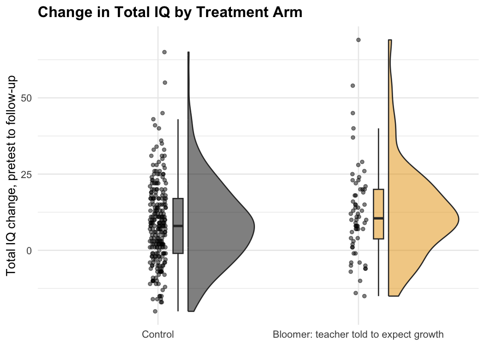
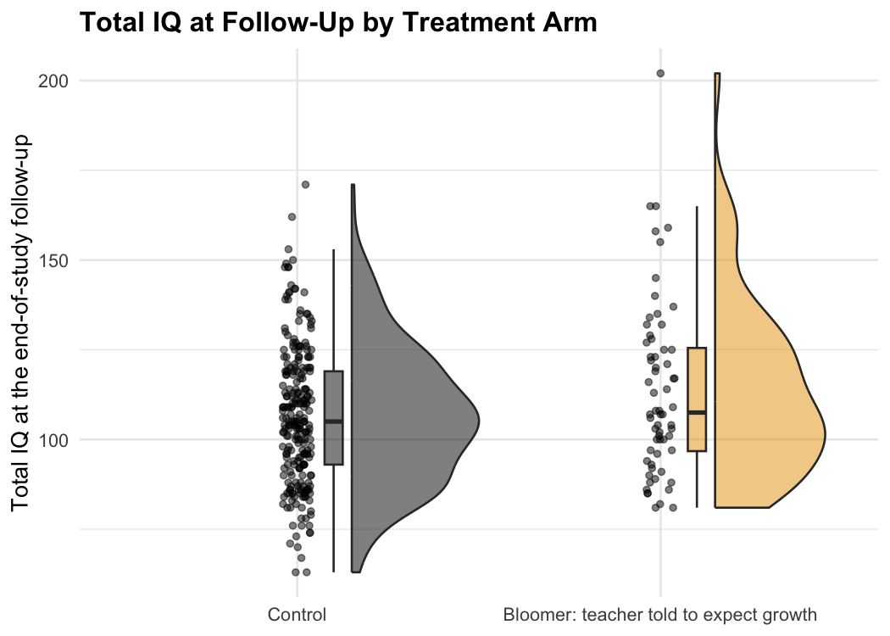
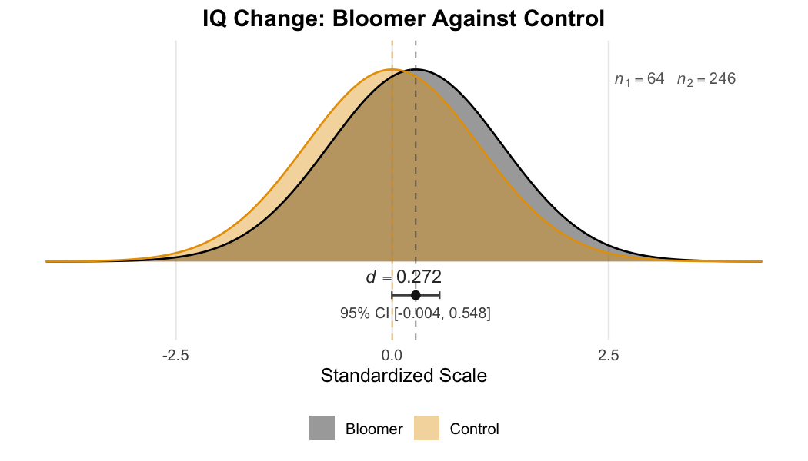
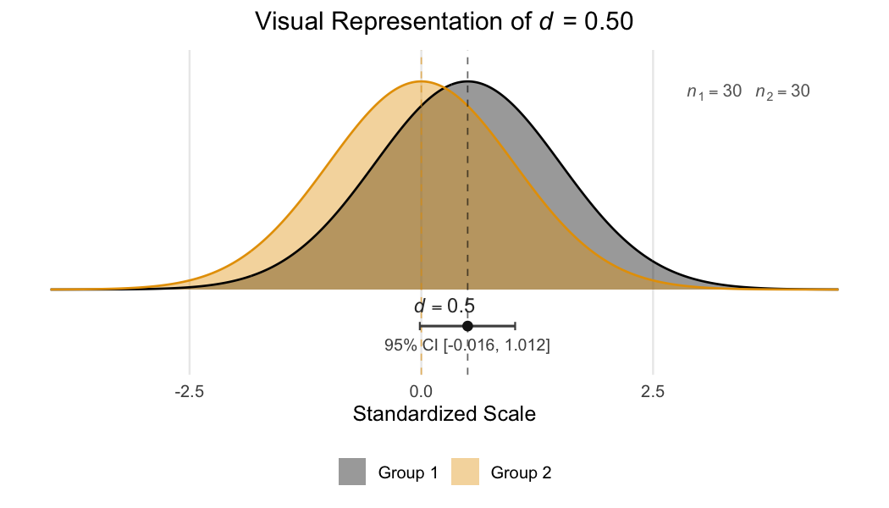
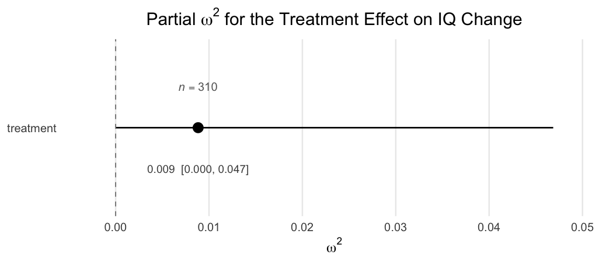
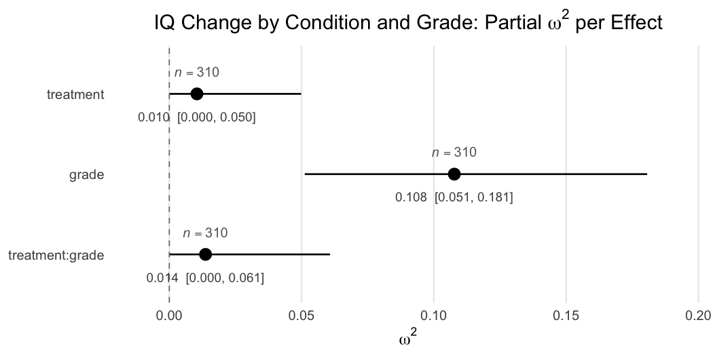
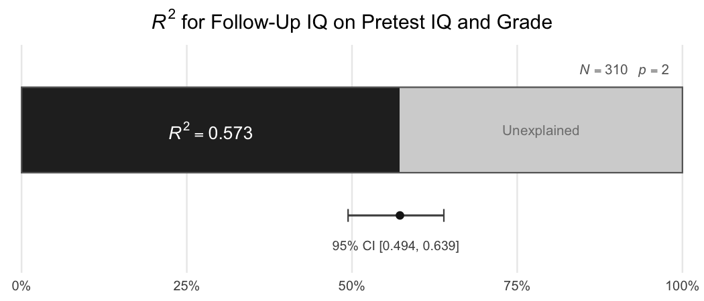
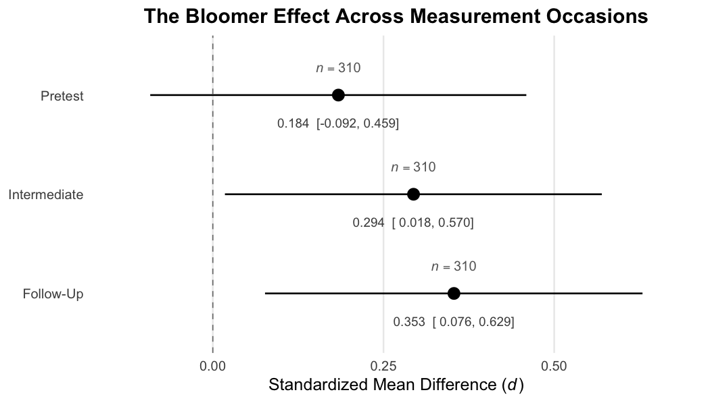

## Introduction

DMAR (*Design, Measurement, and Analysis in R*) is a more general and
greatly expanded reimagining of the MBESS package (Kelley, 2007a,
2007b). Both packages share the same statistical foundations
(confidence intervals for standardized effect sizes, sample size planning
from the accuracy in parameter estimation (AIPE) perspective, and
measurement), but DMAR returns its results as data frames that pass
directly to other R functions for tables and plots.

Although the worked example below draws from educational psychology,
the same tools apply equally to organizational behavior research
(comparing intervention groups on engagement, commitment, or
performance), biostatistics (group comparisons of clinical outcomes),
information systems (user-experience or adoption studies), management
science (process or training-program evaluations), sociology (program
evaluations on attitudinal scales), and any other discipline where the
inferential question is "how large is the effect, and how precisely have
we estimated it?"

MBESS (Kelley, 2007a, 2007b) remains available on CRAN for users with
existing scripts. DMAR is designed for new projects and teaching, and the
functions below take its effect size results directly as input to plots
and reports.

This vignette shows how to:

1. Screen data with `descriptives()`.
2. Visualize group distributions with raincloud plots (via the **ggrain** package).
3. Compute and visualize standardized mean differences, $R^2$, and ANOVA effect sizes with
   `plot_smd()`, `plot_ci()`, and `plot_R2()`.

The effect size plots used here (`plot_smd()`, `plot_R2()`, and
`plot_ci()`) show the confidence interval and the sample size on which
the estimate is based (Cumming, 2012; Kelley & Preacher, 2012).
`plot_smd()` and `plot_R2()` compute the interval from the sample sizes
(`n_1` and `n_2`, or `N` and `p`), so they show the interval and the
sample size when those are supplied (`plot_smd()` also counts them from
the two groups' data). `plot_ci()` takes the limits as
given and shows the sample size when `n` is supplied or can be read
from a DMAR table. `show_n = FALSE` turns off the sample size in all
three, and `show_ci = FALSE` turns off the interval in `plot_smd()` and
`plot_R2()`.

The defaults rest on the view that an effect size, on its own, is not
enough information to interpret. Without an interval, the reader
cannot judge how precisely the effect has been estimated. The default
annotations make these three pieces of information travel together.
When you do choose to suppress them (typically for a slide or a
teaching figure that needs to be visually minimal), the suppression is
a deliberate editorial decision rather than an oversight.


## Setup


``` r
library(DMAR)
```


``` r
library(ggplot2)
```


## The Data

The worked example uses `pygmalion`, which ships with DMAR. These are the
teacher expectancy data from Rosenthal and Jacobson's (1968) *Pygmalion in
the Classroom*, the experiment that gave the Pygmalion effect its name. At
the start of the school year a randomly chosen fifth of the children in
each classroom were described to their teachers as likely intellectual
bloomers. Nothing else about their schooling was manipulated; the
treatment was the expectation planted in the teacher. Intelligence was
measured before the manipulation and at two follow-ups.

| Variable    | Description                                                  |
|:------------|:-------------------------------------------------------------|
| `grade`     | Grade in school at the start of the study                    |
| `treatment` | `Control` or `Bloomer`                                       |
| `iq_pre`    | Total IQ before the manipulation                             |
| `iq_4`      | Total IQ at the intermediate follow-up                       |
| `iq_8`      | Total IQ at the end-of-study follow-up                       |
| `iq_gain`   | `iq_8 - iq_pre`                                              |


``` r
data(pygmalion)

table(pygmalion$treatment)
#> 
#> Control Bloomer 
#>     246      64

knitr::kable(head(pygmalion))
```


| grade|treatment | iq_pre| iq_4| iq_8| iq_gain|
|-----:|:---------|------:|----:|----:|-------:|
|     1|Control   |     45|   58|   76|      31|
|     1|Control   |     75|   62|   85|      10|
|     1|Control   |     61|   82|   87|      26|
|     1|Control   |     84|   86|   86|       2|
|     1|Control   |     65|   76|   78|      13|
|     1|Control   |     72|   94|   94|      22|


Two features of the design shape everything that follows. The arms are
very unequal, 64 bloomers against
246 controls, so precision is
governed by the smaller arm. And because assignment was random, `iq_pre`
carries no treatment effect to find; the difference it shows is the
chance variation a randomized experiment leaves behind, which makes it a
useful yardstick for reading the follow-up differences.

This vignette treats the data as a source of effect sizes to display.
The analysis of covariance these data are best known for, in which the
two groups have different slopes on the pretest, is the subject of
`vignette("pygmalion")`.


## Descriptive Statistics

The `descriptives()` function provides a compact summary useful for data
screening and psychometric work. It reports per-variable sample size,
missingness, central tendency, spread, skewness, and excess kurtosis, all
in a single tidy data frame.


``` r
desc <- descriptives(
  pygmalion[, c("iq_pre", "iq_4", "iq_8", "iq_gain")]
)
knitr::kable(desc$descriptives, digits = 3)
```


|variable |type    |   n| n_missing| prop_missing|    mean| median|     sd| min| max|   q25| q75| skewness| kurtosis|
|:--------|:-------|---:|---------:|------------:|-------:|------:|------:|---:|---:|-----:|---:|--------:|--------:|
|iq_pre   |integer | 310|         0|            0|  98.465|     98| 18.679|  39| 158| 86.00| 109|    0.126|    0.602|
|iq_4     |integer | 310|         0|            0| 101.677|    101| 17.823|  58| 157| 89.25| 112|    0.369|    0.411|
|iq_8     |integer | 310|         0|            0| 107.897|    105| 20.445|  63| 202| 93.00| 120|    0.731|    1.209|
|iq_gain  |integer | 310|         0|            0|   9.432|      9| 13.757| -20|  69|  1.00|  17|    0.796|    1.767|


Skewness and kurtosis values close to zero suggest approximate normality.
As a rough guideline, $|\text{skewness}| > 2$ or $|\text{kurtosis}| > 7$
may warrant concern for normal-theory methods.

Adding `correlations = TRUE` appends a correlation matrix, which is handy
during scale development or when checking multicollinearity.


``` r
desc_cor <- descriptives(
  pygmalion[, c("iq_pre", "iq_4", "iq_8", "iq_gain")],
  correlations = TRUE
)
knitr::kable(desc_cor$correlations, digits = 3)
```


|        | iq_pre|  iq_4|  iq_8| iq_gain|
|:-------|------:|-----:|-----:|-------:|
|iq_pre  |  1.000| 0.720| 0.756|  -0.234|
|iq_4    |  0.720| 1.000| 0.819|   0.240|
|iq_8    |  0.756| 0.819| 1.000|   0.459|
|iq_gain | -0.234| 0.240| 0.459|   1.000|


The pretest correlates strongly with both follow-ups, which is why the
pretest earns its place as a covariate, and it correlates negatively
with the gain score, the familiar consequence of defining a gain as a
difference from the pretest.


## Visualizing Distributions: Raincloud Plots

Raincloud plots (Allen et al., 2019) combine a half-violin, jittered raw
data points, and a boxplot into a single display. They show the full
distributional shape, individual observations, and summary statistics at once.
The **ggrain** package (Patil, 2023) draws them with a single
`geom_rain()` call.


``` r
library(ggrain)

# Source group colors from base R's colorblind-safe Okabe-Ito palette, the
# same palette DMAR's own plot_* functions use.
arm_fills  <- setNames(unname(grDevices::palette.colors(2)),
                       c("Control", "Bloomer"))
arm_labels <- c(Control = "Control",
                Bloomer = "Bloomer: teacher told to expect growth")

ggplot(pygmalion, aes(x = treatment, y = iq_gain, fill = treatment)) +
  geom_rain(alpha = 0.5) +
  scale_fill_manual(values = arm_fills) +
  scale_x_discrete(labels = arm_labels) +
  labs(
    title = "Change in Total IQ by Treatment Arm",
    x     = NULL,
    y     = "Total IQ change, pretest to follow-up"
  ) +
  theme_minimal(base_size = 13) +
  theme(legend.position = "none",
        plot.title = element_text(face = "bold"))
```

<div class="figure" style="text-align: center">

<p class="caption">Raincloud plot of total IQ change from pretest to the end-of-study follow-up, by treatment arm, combining a half-violin density, jittered raw scores, and a boxplot summary (Allen et al., 2019).</p>
</div>


``` r
ggplot(pygmalion, aes(x = treatment, y = iq_8, fill = treatment)) +
  geom_rain(alpha = 0.5) +
  scale_fill_manual(values = arm_fills) +
  scale_x_discrete(labels = arm_labels) +
  labs(
    title = "Total IQ at Follow-Up by Treatment Arm",
    x     = NULL,
    y     = "Total IQ at the end-of-study follow-up"
  ) +
  theme_minimal(base_size = 13) +
  theme(legend.position = "none",
        plot.title = element_text(face = "bold"))
```

<div class="figure" style="text-align: center">

<p class="caption">Raincloud plot of total IQ at the end-of-study follow-up, by treatment arm. The two distributions overlap heavily, and the bloomer arm holds far fewer pupils, which the density curve smooths over and the jittered points do not.</p>
</div>


The raincloud plots give an immediate qualitative impression of group
differences. The next sections quantify those differences with
standardized effect sizes and confidence intervals.


## Standardized Mean Difference

The standardized mean difference (Cohen's $d$) expresses a group difference
in standard-deviation units, making it comparable across studies that use
different measurement scales.
DMAR's `smd()` computes the biased (Cohen) or unbiased (Hedges)
estimate; `ci_smd()` wraps it in a noncentral $t$-based confidence interval.


``` r
# Split the data by treatment arm.
ctrl <- pygmalion$iq_gain[pygmalion$treatment == "Control"]
bloom <- pygmalion$iq_gain[pygmalion$treatment == "Bloomer"]

# Point estimate (Hedges' unbiased g).
smd(group_1 = bloom, group_2 = ctrl, unbiased = TRUE)
```


|term |value |
|:----|:-----|
|smd  |0.272 |


``` r

# 95% confidence interval.
d_hat <- smd(group_1 = bloom, group_2 = ctrl)$value
d_ci  <- ci_smd(smd = d_hat, n_1 = length(bloom), n_2 = length(ctrl))
d_ci
```


|term     |value  |
|:--------|:------|
|ci_lower |-0.004 |
|smd      |0.272  |
|ci_upper |0.548  |

Confidence level: 95%


``` r

# The results-section sentence, written by the package so the numbers
# can never drift from the table they came from.
results_sentence(d_ci, label = "the standardized mean difference")
#> [1] "the standardized mean difference = 0.27, 95% CI [0.00, 0.55]"
```

Reported as one would in a results section, pupils in the bloomer arm
gained more total IQ than controls, but not by an amount this study
pins down:
the standardized mean difference = 0.27, 95% CI [0.00, 0.55].
The interval includes zero, so the data are consistent with no effect,
which matches the omnibus test below
($p = 0.0533$).
The point estimate alone would overstate what the study established; the
interval is what makes the uncertainty visible.

The pretest is the yardstick for reading that interval. Random
assignment guarantees no treatment effect on `iq_pre`, yet the two arms
differ there too:


``` r
d_pre <- smd(group_1 = pygmalion$iq_pre[pygmalion$treatment == "Bloomer"],
             group_2 = pygmalion$iq_pre[pygmalion$treatment == "Control"])$value
ci_smd(smd = d_pre, n_1 = sum(pygmalion$treatment == "Bloomer"),
       n_2 = sum(pygmalion$treatment == "Control"))
```


|term     |value  |
|:--------|:------|
|ci_lower |-0.092 |
|smd      |0.184  |
|ci_upper |0.459  |

Confidence level: 95%


A standardized difference of
0.184 on a measure taken before anything happened is a
reminder of how much of an observed difference this design can generate
on its own. That is the number against which the follow-up differences
have to be read.

### Visualizing With `plot_smd()`

`plot_smd()` draws two unit-variance normal distributions separated by $d$.
The overlap makes the practical meaning of the effect size immediately
visible. Given the two groups' data, as here, or their sample sizes, it
displays a confidence interval and the per-group sample sizes by default.


``` r
plot_smd(
  group_1      = bloom,
  group_2      = ctrl,
  group_labels = c("Bloomer", "Control"),
  title        = "IQ Change: Bloomer Against Control"
)
```

<div class="figure" style="text-align: center">

<p class="caption">Standardized mean difference in total IQ change between the bloomer and control arms, with 95\% confidence interval and per-arm sample sizes, displayed as two unit-variance normal curves separated by the observed \(d\).</p>
</div>

### Visual Representation of $d = 0.50$

`plot_smd()` also accepts a value of $d$ and the sample sizes directly,
which is how it is used to calibrate intuition about a magnitude rather
than to display a particular result.


``` r
plot_smd(smd = 0.50, n_1 = 30, n_2 = 30,
         title = expression(paste("Visual Representation of ", italic(d), " = 0.50")))
```

<div class="figure" style="text-align: center">

<p class="caption">Two unit-variance normal distributions separated by \(d = 0.50\). The separation is real and the overlap is still substantial.</p>
</div>

The figure is a corrective to the common misconception that a
significant $p$-value implies distributions that come apart. At
$d = 0.50$ the two curves are visibly separated and still share most of
their mass, so a randomly chosen member of the higher group is only
somewhat more likely than not to exceed a randomly chosen member of the
lower one.

Numeric reference values for $d$ such as $0.20$, $0.50$, and $0.80$
are sometimes treated as defaults when no field-specific calibration
is available, but they are not a substitute for substantive
interpretation. A $d$ of $0.50$ in a randomized educational
intervention may be substantively important; the same $d$ in a basic
perception experiment may be of little interest. Pairing the plot
with a confidence interval prevents the second mistake that often
accompanies the first, that is, reporting a point estimate as if it were
known with certainty. Pairing it with the per-group sample sizes makes
the precision visible at a glance.


## ANOVA Effect Sizes

### Omega Squared ($\omega^2$)

Omega squared estimates the proportion of variance in the population
accounted for by the fixed effect, correcting for the upward bias
of $\eta^2$ (Olejnik & Algina, 2003). DMAR's `ci_omega_squared()` accepts
either raw ANOVA summary values or a fitted `aov()` object, and reports
the total and the partial $\omega^2$; here `estimand = "partial"` asks
for the partial value, the effect's share of the variance due to the
effect and error alone.


``` r
fit <- aov(iq_gain ~ treatment, data = pygmalion)
print_anova(summary(fit)[[1]])
#>              Df     Sum Sq  Mean Sq  F value Pr(>F)
#> treatment     1   705.8471 705.8471 3.763069 0.0533
#> Residuals   308 57772.2303 187.5722       NA   <NA>
```


``` r
omega_result <- ci_omega_squared(fit, estimand = "partial")
#> Warning: The observed F_value is below the alpha_lower critical value of the
#> central F-distribution, so the lower confidence limit on partial omega squared
#> is 0.
omega_result
```


|effect    |omega_squared_partial |omega_squared_partial_ci_lower |omega_squared_partial_ci_upper |F_value |df_effect |df_error |N   |
|:---------|:---------------------|:------------------------------|:------------------------------|:-------|:---------|:--------|:---|
|treatment |0.009                 |0.000                          |0.047                          |3.763   |1         |308      |310 |

Confidence level: 95%


### Visualizing With `plot_ci()`

`plot_ci()` creates a forest-plot-style display that works with any
DMAR confidence interval output. When it receives output from
`ci_omega_squared()`, it automatically extracts effect names, point
estimates, confidence bounds, and sample sizes.


``` r
plot_ci(omega_result,
        reference_line = 0,
        xlab  = expression(omega^2),
        title = expression(paste("Partial ", omega^2, " for the Treatment Effect on IQ Change")))
```

<div class="figure" style="text-align: center">

<p class="caption">Forest-plot display of partial \(\omega^2\) with 95\% noncentral \(F\) confidence interval (Steiger, 2004) for the treatment effect on IQ change.</p>
</div>

The estimate is small and its interval reaches the zero line, which is
the same conclusion the standardized mean difference reached, expressed
in variance-explained units rather than standard-deviation units.

For factorial designs, `plot_ci()` produces a multi-row forest plot
with one row per effect. The pupils in `pygmalion` were in grades 1
through 6, so crossing the expectancy condition with grade gives a 2 by
6 factorial. Rosenthal and Jacobson (1968) reported the bloomers'
advantage most strongly in the earliest grades, which is a statement
about the condition by grade interaction:


``` r
# Expectancy condition crossed with grade (2 by 6 factorial). Grade is
# stored as a number, so it is made a factor for the analysis.
pygmalion_grades <- transform(pygmalion, grade = factor(grade))
fit_factorial <- aov(iq_gain ~ treatment * grade, data = pygmalion_grades)
omega_factorial <- ci_omega_squared(fit_factorial, estimand = "partial")
#> Warning: The observed F_value is below the alpha_lower critical value of the
#> central F-distribution, so the lower confidence limit on partial omega squared
#> is 0.
omega_factorial
```


|effect          |omega_squared_partial |omega_squared_partial_ci_lower |omega_squared_partial_ci_upper |F_value |df_effect |df_error |N   |
|:---------------|:---------------------|:------------------------------|:------------------------------|:-------|:---------|:--------|:---|
|treatment       |0.010                 |0.000                          |0.050                          |4.273   |1         |298      |310 |
|grade           |0.108                 |0.051                          |0.181                          |8.486   |5         |298      |310 |
|treatment:grade |0.014                 |0.000                          |0.061                          |1.861   |5         |298      |310 |

Confidence level: 95%


``` r

plot_ci(omega_factorial,
        reference_line = 0,
        xlab  = expression(omega^2),
        title = expression(paste("IQ Change by Condition and Grade: Partial ", omega^2, " per Effect")))
```

<div class="figure" style="text-align: center">

<p class="caption">Multi-row forest plot of partial \(\omega^2\) for each effect in the 2 by 6 factorial ANOVA of IQ change on expectancy condition and grade in the pygmalion data. Reading down the rows is the recommended diagnostic for ANOVA model summaries (Maxwell, Delaney, & Kelley, 2027).</p>
</div>

A multi-row forest plot of this kind is read row by row. Each row gives
the partial $\omega^2$ for one effect, with the horizontal bar covering
the confidence interval and the dot marking the point estimate. The
`reference_line = 0` argument draws a vertical guide at zero variance
explained: any interval that crosses that line is consistent with no
effect of that term. Reading down the rows lets you compare the
relative magnitudes of the effects at a glance, and the per-row
confidence intervals show how precisely each effect is estimated.

Here the interaction row bears on the earliest-grades report. Its
partial $\omega^2$ is
0.014,
and its interval runs from
0
to
0.061,
so the omnibus interaction is consistent with a bloomer advantage that
is the same in every grade as well as with one that differs across
grades. That omnibus test spreads whatever pattern there is over 5
degrees of freedom, however, and the differences grade by grade show
where the pattern sits:


``` r
# Mean IQ change of the bloomers minus that of the controls in each
# grade, and the number of pupils in each cell.
gain_means <- with(pygmalion, tapply(iq_gain, list(treatment, grade), mean))
bloomer_advantage <- gain_means["Bloomer", ] - gain_means["Control", ]
round(bloomer_advantage, 2)
#>     1     2     3     4     5     6 
#> 14.78  9.96  0.28  2.46 -0.56 -0.77
cell_n <- table(pygmalion$treatment, pygmalion$grade)
cell_n
#>          
#>            1  2  3  4  5  6
#>   Control 45 46 40 47 25 43
#>   Bloomer  7 12 13 12  9 11
```

The bloomers gained 14.8 and
10.0 IQ points more than the controls
in grades 1 and 2, and between
-0.8 and
2.5 points in grades 3 through 6,
with only 7 to 13
bloomers in any one grade. The sample differences follow the pattern
Rosenthal and Jacobson (1968) reported, concentrated in two of the six
grades, which the omnibus interaction spreads across all six. A 1-df
contrast of grades 1 and 2 against grades 3 through 6 would aim the test
where the pattern sits, but because that contrast is taken from the
published report of these same data, its result would be descriptive,
not confirmatory.

The rows of the forest plot come from R's sequential (Type I) sums of
squares, each term adjusted only for the terms before it in the
formula. Because the cells hold unequal numbers of pupils, the type
matters for the earlier terms: `treatment`, entered first, is not
adjusted for grade, and its *F* of
4.27
becomes
4.82
when it is entered after grade. The interaction, entered last, is the
same under any of the usual types. `?ci_omega_squared` describes how to
supply Type II or III *F* statistics instead.


## Proportion of Variance Explained: $R^2$

The squared multiple correlation $R^2$ answers: "What proportion of the
variance in the outcome is linearly predictable from the set of
predictors?" `plot_R2()` displays this as a horizontal proportion bar,
making the magnitude immediately interpretable.


``` r
reg_fit <- lm(iq_8 ~ iq_pre + grade, data = pygmalion)
print_summary(reg_fit)
#> Coefficients:
#>               Estimate Std. Error    t value Pr(>|t|)
#> (Intercept) 25.8966232 4.16995307  6.2102913 < 0.0001
#> iq_pre       0.8231070 0.04156389 19.8034180 < 0.0001
#> grade        0.2795918 0.45619178  0.6128821   0.5404
#> 
#> Residual standard error: 13.41 on 307 degrees of freedom
#> Multiple R-squared: 0.5725,  Adjusted R-squared: 0.5697
#> F-statistic: 205.6 on 2 and 307 DF, p-value: < 0.0001
```

The number of predictors is a single quantity here (there are two:
pretest IQ and grade), and every sibling function names it the
same way: `p`, whether in `ci_R2()`, `plot_R2()`, or `ci_R()`. We
store it once and pass it along.


``` r
R2_obs <- summary(reg_fit)$r.squared
N      <- nrow(pygmalion)
p      <- 2  # number of predictors

R2_ci <- ci_R2(R2 = R2_obs, N = N, p = p, random_predictors = TRUE)
R2_ci
```


|term     |value |prob_less |prob_greater |
|:--------|:-----|:---------|:------------|
|ci_lower |0.494 |0.025     |0.975        |
|R2       |0.573 |NA        |NA           |
|ci_upper |0.639 |0.975     |0.025        |

Confidence level: 95%


``` r
plot_R2(R2 = R2_obs, N = N, p = p,
        title = expression(paste(italic(R)^2, " for Follow-Up IQ on Pretest IQ and Grade")))
```

<div class="figure" style="text-align: center">

<p class="caption">Squared multiple correlation \(R^2\) with 95\% confidence interval for the regression of end-of-study IQ on pretest IQ and grade.</p>
</div>

The bar makes the "glass half-full, glass half-empty" nature of $R^2$
vivid: even an $R^2$ that is statistically significant may leave
substantial unexplained variance. Here the pretest and grade together
account for
57.3% of the variance in follow-up IQ, so most of
it is accounted for and a substantial share is not.

The accompanying confidence interval makes a second, equally important
point. The interval runs from
0.494 to
0.639, a span of
0.145
even at $N = 310$. Intervals on $R^2$ are wide, and they widen quickly
as the sample gets smaller. Treating the point estimate as the answer,
while ignoring that range, overstates what the data actually show.

### Confidence Interval for the Multiple Correlation $R$

For the multiple correlation $R$ itself, `ci_R()` provides a
confidence interval that can be displayed with `plot_ci()`:


``` r
R_obs <- sqrt(R2_obs)
r_ci  <- ci_R(R = R_obs, N = N, p = p)
r_ci
```


|term     |value |prob_less |prob_greater |
|:--------|:-----|:---------|:------------|
|ci_lower |0.703 |0.025     |0.975        |
|R        |0.757 |NA        |NA           |
|ci_upper |0.799 |0.975     |0.025        |

Confidence level: 95%


``` r

plot_ci(r_ci,
        estimate = R_obs,
        n = N,
        reference_line = 0,
        xlab  = expression(paste("Multiple ", italic(R))),
        title = expression(paste("Confidence Interval for the Multiple Correlation ", italic(R))))
```

<div class="figure" style="text-align: center">

<p class="caption">Confidence interval for the multiple correlation \(R\), constructed from the random-predictor sampling distribution of \(R^2\) (Lee, 1971), the default for `ci_R()`. The sample size is annotated above the interval, where the width of the interval cannot push it off the panel.</p>
</div>


## Combining Multiple Effect Sizes

`plot_ci()` also accepts explicit vectors, so you can build a
side-by-side comparison of different effects:


``` r
# One standardized mean difference per measurement occasion, all from the
# same two arms, so the sample size is the same on every row.
n_b <- sum(pygmalion$treatment == "Bloomer")
n_c <- sum(pygmalion$treatment == "Control")

occasions <- c(iq_pre = "Pretest", iq_4 = "Intermediate", iq_8 = "Follow-Up")

d_vec <- vapply(names(occasions), function(v) {
  smd(group_1 = pygmalion[[v]][pygmalion$treatment == "Bloomer"],
      group_2 = pygmalion[[v]][pygmalion$treatment == "Control"])$value
}, numeric(1))

# Name the 'smd' argument: the first formal of ci_smd() is 'ncp', so a
# positional call would read these as noncentrality parameters.
ci_list <- lapply(d_vec, function(d) ci_smd(smd = d, n_1 = n_b, n_2 = n_c))

plot_ci(
  estimate = d_vec,
  lower    = vapply(ci_list, function(x) x$value[1], numeric(1)),
  upper    = vapply(ci_list, function(x) x$value[3], numeric(1)),
  names    = unname(occasions),
  n        = n_b + n_c,
  reference_line = 0,
  xlab  = expression(paste("Standardized Mean Difference (", italic(d), ")")),
  title = "The Bloomer Effect Across Measurement Occasions"
)
```

<div class="figure" style="text-align: center">

<p class="caption">Standardized mean differences with 95\% confidence intervals for the bloomer effect at three points in the study, displayed as a combined forest plot. The sample size is annotated above each interval, so an interval that runs wide cannot push it off the panel.</p>
</div>

Read down the rows, the display says something the individual estimates
do not. The pretest row, where random assignment guarantees no effect,
is not centered on zero. The two follow-up rows sit further from zero
than the pretest row does, which is the pattern an expectancy effect
would produce, but every interval is wide enough that the ordering of
the three is not established by these data. A forest plot earns its
place here precisely because it puts that comparison in one picture.


## Turning Off Annotations

`plot_smd()` and `plot_R2()` show the confidence interval and the sample
size by default when the sample sizes are supplied. For presentations or
simplified displays, both can be suppressed:


``` r
plot_smd(smd = 0.50, show_ci = FALSE, show_n = FALSE,
         title = expression(paste("Minimal Display of ", italic(d), " = 0.50")))
```

<div class="figure" style="text-align: center">

<p class="caption">Minimal plot suitable for a slide or teaching figure, with confidence interval and sample size suppressed via `show_ci = FALSE` and `show_n = FALSE`.</p>
</div>

In a manuscript or report, the recommendation is to leave both
annotations on. In a slide deck where the same information appears in
the surrounding text, suppression is reasonable.


## Customizing the Plots

Every DMAR plot function returns a `ggplot2` object, which means the
output is a fully editable plot rather than a fixed image. Any layer,
scale, theme, or annotation supported by `ggplot2` can be added on top.


``` r
plot_smd(smd = 0.65, n_1 = 80, n_2 = 80,
         group_labels = c("Treatment", "Control"),
         title = "Reading Intervention") +
  ggplot2::theme(legend.position = "top",
                 plot.title = ggplot2::element_text(size = 14,
                                                    face = "bold")) +
  ggplot2::scale_fill_manual(
    values = c("Treatment" = "#1B7837", "Control" = "#762A83"), name = NULL
  )
#> Scale for fill is already present.
#> Adding another scale for fill, which will replace the existing scale.
```

<div class="figure" style="text-align: center">

<p class="caption">Every DMAR plot returns a `ggplot2` object, so additional `ggplot2` layers can be added with `+`. Here the legend is moved to the top, the title is bold, and the group fills follow a colorblind-friendly palette.</p>
</div>

The same idiom (add `+` followed by another `ggplot2` layer) works for
`plot_ci()` and `plot_R2()` as well. Because the underlying object is
just a `ggplot`, it can be saved with `ggplot2::ggsave()`, embedded in
an R Markdown document, or further composed into multi-panel figures
with packages like `patchwork` or `cowplot`.


## A Note on MBESS

DMAR is a more general and greatly expanded reimagining
of the MBESS package (Kelley, 2007a, 2007b), which remains available
on CRAN. The two share their core methods (confidence intervals for
standardized effect sizes, sample size planning, and measurement).
DMAR differs in three ways that bear on this vignette:

- **Output**: most functions return a data frame, either a `term`
  column beside a numeric `value` column or one row per term with
  typed columns, which passes directly to further analysis and to
  plotting.
- **Visualization**: `plot_smd()`, `plot_ci()`, and `plot_R2()`
  return `ggplot2` graphics that show the confidence interval and the
  sample size, given the sample sizes (`plot_ci()` shows a supplied
  interval without them).
- **Conventions**: `TRUE`/`FALSE` (never `T`/`F`), `warning()`
  instead of `print()` for diagnostics, and `requireNamespace()` for
  optional dependencies.

Scripts written for MBESS continue to run under MBESS, which remains on
CRAN.


## References

Allen, M., Poggiali, D., Whitaker, K., Marshall, T. R., & Kievit, R. A.
  (2019). Raincloud plots: A multi-platform tool for robust data
  visualization. *Wellcome Open Research, 4*, 63.

Cohen, J. (1988). *Statistical power analysis for the behavioral
  sciences* (2nd ed.). Lawrence Erlbaum.

Cumming, G. (2012). *Understanding the new statistics: Effect sizes,
  confidence intervals, and meta-analysis*. Routledge.

Hedges, L. V., & Olkin, I. (1985). *Statistical methods for
  meta-analysis*. Academic Press.

Kelley, K. (2007a). Confidence intervals for standardized
  effect sizes: Theory, application, and implementation. *Journal of
  Statistical Software, 20*(8), 1--24.

Kelley, K. (2007b). Methods for the behavioral, educational, and social
  sciences: An R package. *Behavior Research Methods, 39*(4), 979--984.

Kelley, K., & Preacher, K. J. (2012). On effect size.
  *Psychological Methods, 17*(2), 137--152.

Lee, Y.-S. (1971). Some results on the sampling distribution of the
  multiple correlation coefficient. *Journal of the Royal Statistical
  Society. Series B, 33*(1), 117--130.

Maxwell, S. E., Delaney, H. D., & Kelley, K. (2027). *Designing
  experiments and analyzing data: A model comparison perspective* (4th
  ed.). Routledge.

Olejnik, S., & Algina, J. (2003). Generalized eta and omega squared
  statistics: Measures of effect size for some common research
  designs. *Psychological Methods, 8*(4), 434--447.

Patil, I. (2023). *ggrain: A 'ggplot2' extension for raincloud plots*.
  R package. https://CRAN.R-project.org/package=ggrain

Rosenthal, R., & Jacobson, L. (1968). *Pygmalion in the classroom:
  Teacher expectation and pupils' intellectual development*. Holt,
  Rinehart and Winston.

Steiger, J. H. (2004). Beyond the *F* test: Effect size confidence
  intervals and tests of close fit in the analysis of variance and
  contrast analysis. *Psychological Methods, 9*(2), 164--182.

<!-- precomputed by tools/precompute_vignettes.R from effect-size-visualization.Rmd.orig, md5 5a7a50ca467f2924ae261de5acd221c8. Edit the .Rmd.orig and re-knit; do not edit this file. -->
